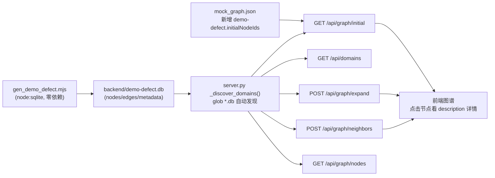

## 产品概述

在现有图谱服务中新增一个独立的测试业务域（与现有 demo-core / demo-region 并列），主题为「缺陷处置中的关联知识应用」：以一张待处理缺陷单为入口，把设备、部件、历史缺陷、检修工单、处置经验等业务对象组织成一张可交互的关联知识图谱，用于演示缺陷原因分析时"看图找知识、跳转看详情"的场景。

## 核心功能

- 新增一个可选业务域，可在域列表中切换，不影响现有两个域
- 入口为一张缺陷单，其详情由后端下发：设备 1# 引风机 / 缺陷 轴承温度异常 / 处理状态 待处理
- 缺陷单详情分三段：基本信息（缺陷编号、设备、部件、缺陷现象、处理状态、缺陷等级、发现时间、发现人、责任人）、缺陷描述与现场记录（温度曲线变化、振动/异音/油位油温等现场检查记录）、关联知识图谱说明
- 关联知识图谱说明含三块固定文案：01 缺陷对象关联（以当前缺陷单为入口，关联所属设备、相关部件及业务记录，快速了解缺陷涉及的设备与历史情况）、02 历史经验参考（关联查看历史相似缺陷、检修记录及处置案例，为缺陷原因分析和处理提供知识参考）、03 跨模块业务跳转（通过关联图谱定位相关设备、工单和知识内容，支持跳转至对应业务页面查看详情）
- 节点主体共 12 类：核心业务链 6 类（设备、部件、缺陷单、历史缺陷、检修工单、经验案例）+ 设备归属 3 类（机组、系统、区域）+ 人员组织 3 类（人员、班组、专业）
- 图谱交互：点击节点看详情卡片、以缺陷单为中心多层展开、单节点"更多邻居"分批加载、按层级高亮关联范围
- 数据规模 80-150 节点，只围绕 1# 引风机这一条完整链路，每条数据和关系都可人工逐条核对

## 视觉与呈现效果

- 缺陷单位于图谱中心，向外辐射设备与部件，再连出历史缺陷、检修工单、经验案例和责任人
- 节点按类别区分颜色，节点大小反映关联数量多少；边以中文关系名相连（如"涉及设备""相似缺陷""执行班组"）
- 「相似缺陷」这类边的粗细体现相似度强弱，一眼能看出哪条历史缺陷最接近当前缺陷
- 选中任一节点即可在侧边详情面板读到该业务对象的完整文字记录，阅读体验与现有域一致

## 技术栈选择

- **不新增任何依赖**：数据生成脚本用 Node 22 内置 `node:sqlite`（`import { DatabaseSync } from 'node:sqlite'`），无需 npm install；实测本机 `node v22.20.0` 可正常读写 SQLite，仅有 `ExperimentalWarning`。
- **后端服务零改动**：`backend/server.py` 的 `_discover_domains()` 用 `Path(DATA_DIR).glob("*.db")` 扫描 `backend/` 目录，**文件名去 `.db` 后缀即域名**。新增 `backend/demo-defect.db` 后 `/api/domains` 自动列出该域。
- 前端零改动：节点详情由 `description` 字段（markdown）下发，`node-detail-card.tsx` 用 `react-markdown` 渲染，正好承载 "缺陷单详情 + 01/02/03 三块说明"。
- 环境注意：本机 `python` 只是 WindowsApps 存根（`python -c` 无输出），后端启动需用 `uv run python server.py`（`uv 0.11.16` 可用）；PowerShell 传参规律为**外层双引号、内层单引号**，例如 `node -e "const{DatabaseSync}=require('node:sqlite');..."`。

## 实现方案

**总体策略**：用一个可重复运行的生成脚本"重建式"产出一个独立 SQLite 图谱库（客户交付要求：脚本 + `.db` 产物），数据表结构完全照抄现有域实测 schema，数据内容按"手写主干 + 固定种子程序化填充"两段式构造，脚本自带自检报告。

**关键决策与取舍**：

1. **重建式而非增量**：脚本先删除 `demo-defect.db`（连同 `-wal`/`-shm`）再全量写入。理由：测试域数据量小（~120 节点），全量重建毫秒级，幂等、可重复、不引入增量合并逻辑（符合 YAGNI）。
2. **主干手写 + 分支程序化**：1# 引风机缺陷这条主干（1 张缺陷单、1 台设备、2 个轴承部件、3 条相似历史缺陷、2 张工单、2 篇处置案例、责任人/班组/专业）全部手写，保证人工可逐条核对；历史缺陷/工单/案例的"长尾"部分用固定种子 PRNG（mulberry32）程序化生成，保证复现性（`--seed` 可调）。
3. **WAL 模式必须保留**：`server.py` 的连接在只读模式下执行 `PRAGMA journal_mode=WAL`。现有 `demo-core.db` 本身就处于 WAL 模式，所以该 pragma 是无害空操作；若新库落在 DELETE 模式，只读连接切换 journal 模式存在抛错风险。因此生成脚本显式设置 `PRAGMA journal_mode=WAL`，写入结束做 `wal_checkpoint(TRUNCATE)` 后再关闭，保证产物与现有库形态一致。
4. **字段语义对齐现有域**：`size = 20 + min(degree*2, 30)`（20~50）；`rank` = 同一 category 内按度数降序的序号（`_get_neighbor_ids_sorted` 按 rank 升序取邻居，rank 越小越先被展开）；`color` 按类别映射；`edges.category` 用 `A-B` 形式、`edges.label` 用中文关系名。`weight` 在现有数据里恒为 1，这里复用为"相似度/关联强度"（1~5），经 `lineWidth = clamp(weight*0.8, 1, 4)` 映射为视觉粗细，属于对既有字段的合理扩展。
5. **frontmatter 与 description 分工**：`server.py` 的 `row_to_node()` 只读取列、不解析 frontmatter，因此真正决定 UI 内容的是 `description`。frontmatter 仍按现有 JSON 风格（title/type/status/负责人/created/modified 等）写入，保持数据形态一致，便于后续扩展；详细业务内容全部落在 `description`。
6. **与前端渲染约束对齐**：`app-config.json` 中 `maxTotalNodes: 100`、`batchLoad.pageSize: 5`，因此总量控制在 ~120 且单节点直接邻居数 ≤ 12，既能在画布上大多加载完，又保留"更多邻居"分页演示空间；`categoryColors.usePalette=true / paletteThreshold=20`，唯一类别 12 个 ≤ 20，前端会按 category 名字重新分配颜色并覆盖后端 `color`，因此配色以类别名集合为准（后端 color 仍写入，供关闭调色板时使用）。

**性能**：单次全量写入置于一个事务内、使用预编译 statement；~120 节点 / ~250 条边下耗时在毫秒级，无 N+1、无重复遍历。自检与后处理（度数、rank、size）均为 O(V+E) 单遍扫描。

## 实现说明（执行要点）

- **幂等**：脚本每次运行前删除 `demo-defect.db`、`-wal`、`-shm`；`metadata` 表写入 `source=gen_demo_defect.mjs`（现有库该表存 `directory` 键，服务端并不读取，仅保持表结构完整）。
- **路径解析**：用 `new URL('./demo-defect.db', import.meta.url)` 定位产物，避免依赖当前工作目录。
- **description 写作约束**：只用 `##` 标题 + `- **字段**: 值` 列表（前端只对 `h2`/`ul`/`li` 做了样式，无表格样式），不要用 markdown 表格、`#` 一级标题或内联 HTML；换行符用 `\n`（前端已把 `\r\n` 处理为两空格换行）。
- **不触碰无关文件**：`server.py`、`init_graph_fields.py`（针对旧的 `.quartz-cache.db`）、`add_description.py` 都不修改；不动前端任何文件。
- **回归安全**：新库加入后 `DOMAIN_NAMES` 变为 `demo-core / demo-defect / demo-region`，`DEFAULT_DOMAIN` 仍是 `demo-core`（sorted 首位不变），现有默认行为不受影响。
- **验证方式**：脚本自带自检报告（节点/边/类别计数、孤立节点、入口不可达节点、重复 id 与重复边、各类别最大度数、description 覆盖率、`PRAGMA journal_mode` 是否为 `wal`）；接口链路用 `node -e "fetch('http://localhost:8002/api/domains')..."` 或不依赖引号的 `curl.exe` 校验。
- **风险与兜底**：若 `uv run python server.py` 因需下载 CPython 3.14 受限，可退化为 `uv venv` + 本地已有解释器，或仅用 node 直接读取 db 做数据校验（数据层与 HTTP 层可分开验证）。

## 架构设计



## 目录结构

```
backend/
├── gen_demo_defect.mjs   # [NEW] 缺陷处置测试域数据生成脚本（node ESM + node:sqlite，零依赖）。
│                         #   职责：1) 幂等重建 demo-defect.db（含 nodes/edges/metadata 三张表，DDL 照抄
│                         #   现有域实测 schema）；2) 定义 12 类节点主体与中文关系映射表（含 label/category/
│                         #   color/weight），构建手写主干数据与固定种子程序化长尾数据；3) 后处理：按度数
│                         #   计算 size、按 category 内度数降序计算 rank、按类别填 color；4) 单事务批量写入并
│                         #   设置 WAL + checkpoint；5) 打印自检报告（计数、孤立/不可达节点、重复 id/边、
│                         #   类别数、最大度数、description 覆盖率、journal_mode）。
│                         #   参数：--scale small|medium|large（默认 small ≈120 节点）、--seed（默认固定值）。
│                         #   形态：`node backend/gen_demo_defect.mjs`
├── demo-defect.db        # [NEW] 生成产物（SQLite 图谱库，随脚本一起提交；如附带 -wal/-shm 与现有库保持一致）
├── mock_graph.json       # [MODIFY] 新增 "demo-defect": { "initialNodeIds": ["缺陷单/defect-0001"] }，
│                         #   使 /api/graph/initial?domain=demo-defect 首屏返回缺陷单中心节点；不改动现有两项
└── Readme.md             # [MODIFY] 补充该域的生成命令、访问 URL 示例与自检说明（接口契约不变，
                          #   API文档.md 无需改动）
```

## 关键数据结构

```sql
-- nodes / edges：与 backend/demo-core.db 实测 schema 完全一致（含 CHECK 约束与 UNIQUE 约束）
CREATE TABLE nodes (
  id TEXT PRIMARY KEY,
  type TEXT NOT NULL CHECK(type IN ('entity','virtual','tag')),
  mtime INTEGER, frontmatter TEXT,
  date_created TEXT, date_modified TEXT, date_published TEXT,
  size INTEGER NOT NULL DEFAULT 20, category TEXT NOT NULL DEFAULT '默认',
  color TEXT NOT NULL DEFAULT '#94a3b8', label TEXT NOT NULL DEFAULT '',
  domain TEXT NOT NULL DEFAULT '', rank INTEGER NOT NULL DEFAULT 0, description TEXT DEFAULT ''
);
CREATE TABLE edges (
  edge_id INTEGER PRIMARY KEY AUTOINCREMENT,
  source TEXT NOT NULL, target TEXT NOT NULL,
  type TEXT NOT NULL CHECK(type IN ('link','tag')),
  weight REAL NOT NULL DEFAULT 1.0, category TEXT NOT NULL DEFAULT '默认',
  color TEXT NOT NULL DEFAULT '#cbd5e1', label TEXT NOT NULL DEFAULT '关联',
  domain TEXT NOT NULL DEFAULT '', UNIQUE(source, target, type)
);
CREATE TABLE metadata (key TEXT PRIMARY KEY, value TEXT);
```

关系映射（写入 `edges.label` / `edges.category`，`weight` 用于相似度加权）：

| 源类别 → 目标类别 | 边 label | edge category | weight |
| --- | --- | --- | --- |
| 机组 → 系统 | 包含系统 | 机组-系统 | 1 |
| 系统 → 设备 | 包含设备 | 系统-设备 | 1 |
| 区域 → 设备 | 位于区域 | 区域-设备 | 1 |
| 设备 → 部件 | 包含部件 | 设备-部件 | 1 |
| 缺陷单 → 设备 | 涉及设备 | 缺陷单-设备 | 3 |
| 缺陷单 → 部件 | 指向部件 | 缺陷单-部件 | 3 |
| 缺陷单 → 人员 | 责任人 | 缺陷单-人员 | 2 |
| 缺陷单 → 历史缺陷 | 相似缺陷 | 缺陷单-历史缺陷 | 1~5（相似度） |
| 缺陷单 → 检修工单 | 关联工单 | 缺陷单-检修工单 | 2 |
| 历史缺陷 → 设备 / 部件 | 涉及设备 / 指向部件 | 历史缺陷-设备 / 历史缺陷-部件 | 1 |
| 检修工单 → 设备 / 部件 | 检修对象 | 检修工单-设备 / 检修工单-部件 | 2 |
| 检修工单 → 班组 | 执行班组 | 检修工单-班组 | 1 |
| 检修工单 → 经验案例 | 沉淀案例 | 检修工单-经验案例 | 2 |
| 经验案例 → 历史缺陷 / 部件 | 源自缺陷 / 适用部件 | 经验案例-历史缺陷 / 经验案例-部件 | 1 |
| 经验案例 → 人员 | 编写人 | 经验案例-人员 | 1 |
| 人员 → 班组 / 专业 | 所属班组 / 所属专业 | 人员-班组 / 人员-专业 | 1 |


节点主体（`category` 与 id 前缀同名，数量为 small 规模目标值）：

| category | id 示例 | 数量 | 说明 |
| --- | --- | --- | --- |
| 机组 | `机组/unit-0001` | 2 | 1# 机组、2# 机组 |
| 系统 | `系统/sys-0001` | 6 | 烟风系统、制粉系统、汽水系统、润滑油系统等 |
| 区域 | `区域/area-0001` | 4 | 引风机房、锅炉本体区、汽机房等 |
| 设备 | `设备/fan-0001` | 12 | 1# 引风机（入口设备）、送风机、一次风机、电机等 |
| 部件 | `部件/bearing-0001` | 16 | 非驱动端轴承、叶轮、联轴器、润滑油泵等 |
| 缺陷单 | `缺陷单/defect-0001` | 1 | 本域入口：1# 引风机 / 轴承温度异常 / 待处理 |
| 历史缺陷 | `历史缺陷/hdefect-0001` | 20 | 与轴承温度、振动、油质相关的历史缺陷 |
| 检修工单 | `检修工单/wo-0001` | 14 | 已闭环工单，含检修内容与结论 |
| 经验案例 | `经验案例/case-0001` | 12 | 处置经验、故障分析案例 |
| 人员 | `人员/person-0001` | 8 | 点检员、检修负责人、专业工程师 |
| 班组 | `班组/team-0001` | 4 | 机械一班、电气班、仪控班等 |
| 专业 | `专业/spec-0001` | 4 | 机械、电气、仪控、热工 |


合计约 103 节点、约 200-260 条边（在 80-150 节点区间内，且留出"更多邻居"分页空间）。

## Agent Extensions

### Skill

- **agent-browser**
- Purpose: 数据与接口就绪后，用于打开前端页面验证 demo-defect 域的真实渲染效果（域加载、以缺陷单为中心展开、选中节点后详情面板中的"缺陷描述与现场记录 + 01/02/03"文案是否正确显示）
- Expected outcome: 得到页面加载无控制台报错、图谱节点/边正常出现、缺陷单详情内容与后端 description 一致的验证结论与截图证据；若画布交互无法合成事件触发，则退化为验证页面加载 + 拓扑接口返回 + 详情面板文案三项